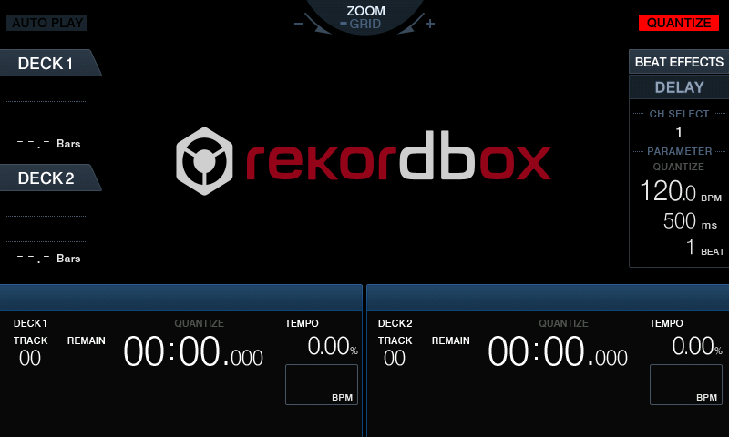

# Pioneer XDJ-RX firmware — reverse engineering notes

Goal: understand the XDJ-RX firmware structure, architecture, and update
mechanism, with a view to **adding exFAT USB support** and, as a first
milestone, **booting the firmware in QEMU**. Work is done on hardware the owner
possesses, using Pioneer's own publicly-published GPL source, for
interoperability and preservation.

- **Device:** Pioneer XDJ-RX (internal platform name **`XDJAERO`**)
- **Firmware analysed:** `2.21` (built 2017-10-18, the last XDJ-RX release)
- **SoC:** NXP/Freescale **i.MX6Q** (`MCIMX6U6…`), dual Cortex-A9 @ 800 MHz
- **Kernel:** Linux **3.0.35** (Freescale BSP `L3.0.35_4.1.0`), U-Boot 2009.08
- **Storage:** GPMI NAND (layout below), plus the panel microcontroller

---

## Milestone: the firmware boots to its UI in QEMU

The **unmodified** `2.21` firmware boots on an emulated i.MX6 (QEMU `-M sabrelite`,
patched to the XDJ-RX's real SABRE-SD board) all the way to its on-screen UI. No
firmware or kernel changes — the i.MX6 bring-up (IPU vsync, framebuffer scanout,
panel-MCU SPI, thermal/GPU stubs) is modelled on the QEMU side. The boot splash
renders at 32bpp; the app then switches the framebuffer to 16bpp RGB565 and the
main screen comes up. Both are decoded live from the IPU display stride.


Boot splash (32bpp)

 
 Main UI (16bpp RGB565)

*Actual emulator framebuffer (800×480) captured from the running QEMU instance —
see [`qemu/watch.sh`](qemu/watch.sh).*

---

## 1. The `.UPD` file format (fully reverse-engineered)

`XDJRX.UPD` is an **ISO9660 image encrypted with Linux `cryptoloop`** (the
`losetup -e aes` scheme), followed by a small plaintext footer:

```
+-------------------------------------------------------------+
| encrypted body : N × 512 bytes   (cryptoloop AES-256-CBC)   |
+-------------------------------------------------------------+
| model string   : 12 bytes        "XDJAERO2.21\0"            |
| body CRC32      : 4 bytes, little-endian  = crc32(body)     |
+-------------------------------------------------------------+
```

For 2.21: `48,363,536` bytes = `94,460 × 512` (body) + `16` (footer).

### Crypto parameters (verified against source)

| Parameter | Value | Source of truth |
|-----------|-------|-----------------|
| Cipher / mode | `cbc(aes)`, **AES-256** | `linux-3.0.35/drivers/block/cryptoloop.c` (`cms` → `cbc(aes)`) |
| Key | 32 bytes: first line of `aes256.key`, bytes **`[0:31]` + one `0x00`** | `util-linux-ng-2.13/mount/lomount.c` + `include/xstrncpy.h` (`strncpy(dst,src,31); dst[31]=0`), `LO_KEY_SIZE=32` |
| Per-sector IV | **`LE32(sector_index) ‖ 12×0x00`**, incrementing every 512 B from body start | `cryptoloop.c` (`iv[0]=cpu_to_le32(IV)`) + `loop.c` (`IV = offset>>9`, offset 0) |
| Footer CRC | `zlib.crc32(encrypted_body)`, stored little-endian | measured, byte-exact |

The on-device decrypt routine that reveals all of this is
`initramfs/decrypt_update.sh`:

```sh
cat /usr/local/pioneer/aes256.key | losetup -e aes -p 0 $dev $filename
mount $dev /mnt/iso          # inner volume is ISO9660, label "UsbAuto"
./update USB ${language}      # run the updater from inside the image
```

### Where the key comes from (and why this is legitimate)

The XDJ-RX runs embedded Linux, so Pioneer must publish the GPL/LGPL source.
That public release **contains the key**:

> `pioneer_xdj_rx.tar.gz` → `pioneer_xdj_rx/initramfs.tar.gz` →
> `initramfs/usr/local/pioneer/aes256.key`

Download: Pioneer "GNU Open Source License & GPL/LGPL Source Code" page →
**XDJ-RX** (v1.00 / 1.40 / 1.50). The parts are `deflate64` ZIPs wrapping
`pioneer_xdj_rx.tar.gz.00` / `.01`; concatenate then `tar xzf`. The AES key is
unchanged across firmware versions, so the 1.50-era key decrypts 2.21.

**The key is never stored in this repo.** [`fetch_key.py`](fetch_key.py)
resolves it on demand and writes it to `.env` (git-ignored) as
`XDJRX_AES_KEY=<64 hex>`. It uses a cached `build/aes256.key` if present,
otherwise downloads the GPL parts, unwraps the deflate64 ZIPs, streams the two
nested tars, extracts `aes256.key`, and derives the 32-byte key. Everything the
scripts pull or generate lands under `build/`; both `.env` and `build/` are
git-ignored.

---

## 2. Reusable tool — `xdjrx_upd.py`

**Setup** — install dependencies once:

```bash
python3 -m venv .venv && source .venv/bin/activate   # optional but recommended
pip install -r requirements.txt
```

Or skip manual setup entirely with [uv](https://docs.astral.sh/uv/) — the scripts
carry [PEP 723](https://peps.python.org/pep-0723/) inline metadata, so
`uv run xdjrx_upd.py …` / `uv run fetch_key.py` resolve and install deps in an
ephemeral environment automatically.

```bash
# First time only: resolve the AES key into .env (see §1)
python3 fetch_key.py          # or: uv run fetch_key.py
#   fast if build/aes256.key exists; otherwise downloads ~280 MB of GPL source
#   (that download path needs inflate64 — covered by requirements.txt / uv)

# The .UPD argument may also be the Pioneer-shipped .zip that contains it —
# the tool finds and unwraps the .UPD member automatically:
#   python3 xdjrx_upd.py info  XDJ-RX_v2.21.zip
#   python3 xdjrx_upd.py decrypt XDJ-RX_v2.21.zip -o build/XDJRX.iso

# Inspect (verifies key + footer CRC, finds the ISO9660 magic)
python3 xdjrx_upd.py info XDJRX.UPD

# Decrypt to an ISO you can mount/inspect
python3 xdjrx_upd.py decrypt XDJRX.UPD -o build/XDJRX.iso

# Decrypt AND unpack the ISO tree — pure-Python (pycdlib), cross-platform,
# no mounting; falls back to 7z / bsdtar / hdiutil only if pycdlib is absent
python3 xdjrx_upd.py extract XDJRX.UPD -d build/contents

# Re-pack a modified ISO into a flashable .UPD (re-encrypt + fix footer CRC)
python3 xdjrx_upd.py pack modified.iso -o XDJRX_custom.UPD --model XDJAERO2.21

# Use your own key file instead of the built-in key
python3 xdjrx_upd.py --key-file build/aes256.key decrypt XDJRX.UPD
```

`pack` is byte-exact: re-packing the untouched ISO reproduces the original
`.UPD` bit-for-bit — so a modified image will be a valid update file.

> ⚠️ Flashing a custom `.UPD` to real hardware is at your own risk. The device
> has **A/B kernel banks** (see below) which gives some brick resistance, but
> there is no guarantee. Validate in QEMU / on a sacrificial unit first.

---

## 3. What's inside the firmware (`build/contents/`)

Decrypted ISO (volume `UsbAuto`) — the updater and everything it flashes:

| Path | What it is |
|------|------------|
| `update` | ARM ELF updater (dynamically linked, not stripped) — the update orchestrator |
| `mot2bin` | Motorola S-record → binary converter (for the panel MCU image) |
| `lib/`, `usr/lib/`, `gui/` | shared libs + GUI assets used by `update` itself |
| `images/uImage` | **Linux kernel** — `Linux-3.0.35-2666-gbdde708`, ARM, uncompressed, load/entry `0x10008000` |
| `images/u-boot.bin.nand` | U-Boot bootloader (NAND build) |
| `images/rootfs.cramfs` | **root filesystem**, CRAMFS, ~17 MB, 1075 files (contains `fuse.ko`, `libfuse`, `fusermount`, udev rules) |
| `images/pioneer.tar.gz` | Pioneer application payload |
| `images/gui.tar.gz` | GUI resources |
| `images/user.tar.gz`, `images/data.tar.gz` | user/data overlays |
| `images/PANELCOM.mot` | **panel microcontroller** firmware (S-record) |
| `images/fw_env.txt` | U-Boot environment (boot flow + NAND partition map) |
| `images/release.txt`, `*.rev` | version `2.21`, SVN build provenance |

### Boot flow & NAND layout (from `fw_env.txt`)

```
bootcmd = run bootcmd_nand
bootcmd_nand = run bootargs_base bootargs_nand bootargs_nand_${kernel_bank}; bootm
  → nand read 0x10800000 0x500000 0x500000   (kernel bank A @ 5 MiB)
bootargs = console=ttymxc0,115200 ... mtdparts=... consoleblank=0 video=mxcfb0 rootwait
```

NAND partitions (`mtdparts`):
`3M(boot) 1M(bb1) 1M(env) 10M(kernel_a) 10M(kernel_b) 30M(rootfs) 10M(data)
8M(pioneer) 5M(bb2) 10M(core) 40M(gui) 122M(quickboot) 5M(bb2) 1M(bbt)`

Notes:
- **Dual kernel banks A/B** → safer updates (fall back if one is bad).
- U-Boot env also defines **MMC** (`rootfstype=ext4`) and **NFS** boot paths —
  the NFS path (`root=/dev/nfs nfsroot=…`) is the most practical for dev/QEMU.
- Console is **`ttymxc0` @ 115200**, 8N1.

---

## 4. exFAT support — feasibility

**USB drives are mounted as `vfat` only.** The updater's mount helper
(`initramfs/mount_usb.sh`) does `mount -t vfat …`; the main app mounts USB media
via a udev rule `12-usb-memory-auto-mount.rules` in the rootfs. The kernel
(3.0.35, 2012) predates mainline exFAT (5.4, 2019) — **no native exFAT** and
`NTFS`/`exFAT` are both off in the config. But:

- `CONFIG_FUSE_FS=m` **and the rootfs already ships FUSE** (`fuse.ko`,
  `libfuse.so`, `fusermount`, `fuse.conf`, `99-fuse.rules`). The device already
  uses FUSE (e.g. `simple-mtpfs`).

**Recommended route: userspace `fuse-exfat` (relan/exfat).**
1. Cross-compile `fuse-exfat` (`mount.exfat-fuse`) for armv7-hf against this
   BSP's toolchain/libfuse.
2. Inject the binary + libs into `rootfs.cramfs` (rebuild the cramfs).
3. Patch the mount path (the udev rule + any `mount -t vfat` call sites) to try
   `exfat` when `vfat` fails — the natural hook is
   `12-usb-memory-auto-mount.rules`.
4. Re-pack with `xdjrx_upd.py pack`.

Alternative: backport a kernel exFAT driver (Samsung `sdFAT` / staging `exfat`)
as a `.ko` for 3.0.35 — faster at runtime, but a bigger porting job and needs a
kernel rebuild. Start with FUSE.

> Open question worth checking early: whether the Pioneer app enumerates the
> USB filesystem itself (and only understands FAT) rather than just relying on
> the mounted path. If so, the app's expectations — not just the mount — may
> need attention. Inspect `pioneer.tar.gz` + the `update`/app binaries next.

---

## 5. QEMU boot — **the live UI runs** (see [QEMU.md](QEMU.md))

The **unmodified firmware boots in QEMU all the way to its live UI** — the
Pioneer DJ / rekordbox splash, then the main deck screen (DECK1/DECK2, BEAT
EFFECTS, BPM/TEMPO). One command does everything from scratch:

```bash
./run.sh      # download firmware → key → decrypt → build QEMU → build nand.img → launch
```

`run.sh` is idempotent (skips finished steps). The individual steps:

```bash
./run.sh            # or, by hand:
qemu/build-qemu.sh                                         # patched QEMU (once, ~15 min)
python3 xdjrx_upd.py decrypt XDJRX.UPD -o build/XDJRX.iso  # decrypt firmware
python3 qemu_prepare.py                                    # kernel boot blobs
qemu/build-nand.sh                                         # nand image (needs e2fsprogs)
qemu/watch.sh                                              # live display + serial console
```

What it took (all **emulator-side, firmware untouched** except one removed file):
- **Machine-id trampoline** — QEMU's `-M sabrelite` passes board-id `-1`; this
  ATAG kernel rejects it (silent spin in `dump_machine_table`). A tiny trampoline
  supplies the real board's machine id **3980 (SABRE-SD)** + hand-built ATAGs
  (incl. `ATAG_REVISION=0x500`, which binds the `subucom` panel MCU) via
  `-device loader`.
- **Three i.MX6 QEMU patches** (`qemu/patches/`) — self-clearing SRC GPU-reset
  bits; a Vivante GPU register stub + a live framebuffer scanout (reads the IPU
  display stride, decodes 32bpp splash / 16bpp RGB565 UI) + IPU vsync IRQ; and the
  SABRE-SD board wiring (uSDHC3 nand, ECSPI2 subucom slave).
- **nand image** (`qemu/build-nand.sh`) — assembled from the firmware's own
  payloads (`rootfs.cramfs` + `pioneer.tar.gz` + `gui.tar.gz`) as a 256 MB ext4
  image. The **one** change vs. a byte-for-byte rootfs: the Vivante GAL DirectFB
  gfxdriver (`libdirectfb_gal.so`) is removed so DirectFB software-renders without
  `/dev/galcore` — QEMU can't emulate the i.MX6 DDR bus-frequency DVFS the GPU
  driver needs, and the GPU does no work in the idle UI anyway. See
  [docs/emulator-status.md](docs/emulator-status.md).

---

## 6. Repro: rebuilding from Pioneer's GPL source

```bash
# 1. Download XDJ-RX GPL parts (deflate64 ZIPs) from Pioneer's GPL/LGPL page.
# 2. Unwrap each ZIP (ditto/7z fail on deflate64; use python 'inflate64'):
pip install inflate64
#    -> pioneer_xdj_rx.tar.gz.00 / .01
cat pioneer_xdj_rx.tar.gz.00 pioneer_xdj_rx.tar.gz.01 > pioneer_xdj_rx.tar.gz
tar xzf pioneer_xdj_rx.tar.gz
tar xzf pioneer_xdj_rx/initramfs.tar.gz      # -> initramfs/usr/local/pioneer/aes256.key
```

Source tree of note:
`BUILD/linux-3.0.35/` (kernel + `.config`), `BUILD/u-boot-2009.08/`,
`BUILD/busybox-1.20.2/`, `tools/` (fuse, simple-mtpfs, util-linux, hfsprogs…),
`config/platform/imx/imx6q.cf`.

---

## Files in this folder

Tracked in git (the whole repository):

```
run.sh                   one command: download → key → decrypt → build → launch
xdjrx_upd.py             decrypt / info / extract / pack the .UPD (reads key from .env)
fetch_key.py             resolve the AES key from Pioneer's GPL source -> .env
qemu_prepare.py          build the QEMU kernel boot blobs (kernel, trampoline, ATAGs)
requirements.txt         Python deps (pip install -r; also PEP 723 in each script)
README.md / QEMU.md      this document / the QEMU bring-up writeup
.gitignore               excludes .env, build/ and the firmware image
docs/img/                bring-up screenshots used in this README
qemu/build-qemu.sh       build the patched QEMU (applies qemu/patches/*.patch)
qemu/build-nand.sh       assemble the nand image (uses cramfs_extract.py)
qemu/cramfs_extract.py   extract the firmware's rootfs.cramfs
qemu/watch.sh            launch the emulator — live UI on the real SABRE-SD board
qemu/patches/            01 SRC GPU-reset · 02 i.MX6 GPU/IPU/scanout stubs · 03 SABRE-SD SD
```

You supply (not in git — Pioneer's copyrighted firmware):

```
XDJRX.UPD                the original encrypted firmware (2.21), from your device/update
```

Generated by the scripts (git-ignored, see `.gitignore`):

```
.env                     XDJRX_AES_KEY=<hex>   (created by fetch_key.py)
build/aes256.key         passphrase cached from the GPL source
build/XDJRX.iso          decrypted ISO9660 image (mountable)
build/qemu/              kernel, boot blobs, nand.img, reference logs
build/qemu-src/          the patched QEMU source + build
```

## Status / next steps

- [x] `.UPD` format fully specified; decrypt + byte-exact re-pack working
- [x] Update mechanism, boot flow, NAND layout, component inventory mapped
- [x] **Firmware boots in QEMU to its live UI** (one gfxdriver removed) — [QEMU.md](QEMU.md)
- [x] **GUI bringup** done: IPU display model, framebuffer scanout, app runs (software render)
- [ ] **Button input**: inject the Subucom panel-MCU SPI frames (buttons/jogs/faders)
- [ ] exFAT mod: patch `12-usb-memory-auto-mount.rules`; cross-compile `fuse-exfat`
