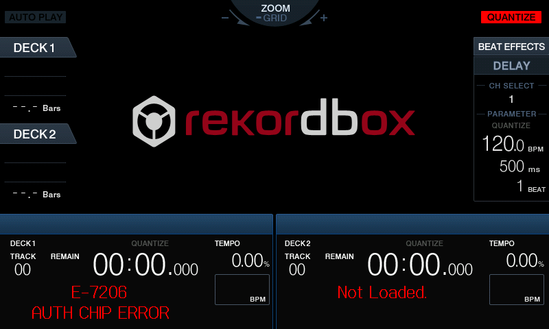

# XDJ-RX emulator — feature status & findings

Status of the standalone-emulator effort (QEMU `-M sabrelite` patched to the
XDJ-RX's real SABRE-SD board). The goal: a packaged emulator that takes only the
**unmodified** `.UPD` firmware, used to develop device features (exFAT, FLAC, …).
Prefer QEMU-side changes over firmware edits; exFAT/FLAC are device features that
will modify the firmware (the emulator is the dev/test vehicle).

Legend: ✅ done · 🔶 partial/diagnosed · ⬜ investigated, not started · ❌ blocked

## ✅ Boot to the live UI (unmodified firmware)
Splash (32bpp) + main UI (16bpp RGB565) render; dynamic bpp scanout reads the IPU
display stride. Launch: `qemu/watch.sh`. Uses `nand.img` (the GAL
DirectFB gfxdriver removed so DirectFB software-renders). Committed.

## ✅ A. galcore / Vivante GPU — resolved by shipping nand.img
The built-in galcore (Vivante) driver probes at boot and fails `-22` (no real GPU),
which is harmless: `nand.img` has the one DirectFB GAL gfxdriver
(`libdirectfb_gal.so`) removed, so the UI software-renders without `/dev/galcore`
(the GPU is only used for an unreached `g2d_blit`). The baseline GPU register stub
(patch 02) just makes that `-22` clean rather than a hang.

**Why not a byte-for-byte rootfs?** Making galcore fully initialise is blocked by a
feature QEMU does not model. Deep RE (the `-22` was root-caused and cleared; boot then
hangs) showed the real blocker is **not galcore** but the **i.MX6 bus-frequency DVFS**
it triggers once the GPU clocks are enabled: `set_high_bus_freq` does an ARM-clock /
DDR frequency change with CPU IRQs masked, waits for a settling timer tick, and — even
once that tick is delivered — **retry-loops in the clk framework because QEMU models no
MMDC** (DDR controller, phys 0x021b0000), so the DDR frequency transition never
completes/verifies. Closing it would mean modelling the i.MX6 MMDC + DDR DVFS, a
substantial undertaking, so the experiment was removed (it lives in git history:
commits for the 2D-core identity + `imx_gpt_kick` + CCM CACRR trap) and we ship the
gfxdriver-removed image. The GPU does no work in the idle UI, so nothing is lost
visually. RE tooling used: QEMU `-gdb` + a raw-RSP python client, kernel VA→phys
page-table walk, and Ghidra (REA) on a sliced region ELF (the full 13 MB kernel times
out Ghidra's import).

## 🔶 B. Ethernet → rekordbox LAN link
FEC is modeled and `eth0` now **comes up on the LAN**. The firmware's
`/etc/rc.d/init.d/network` only configures eth0 when `rc.conf` sets
`SYSCFG_IFACE0=y`, and the apl_start boot path never runs it — so build-nand.sh
injects `ifconfig lo up; udhcpc -b -i eth0 … &` into apl_start (DHCP client,
backgrounded so it can't block the UI). `watch.sh` attaches a QEMU nic to the FEC.
The **default is user-mode NAT** so `./run.sh` opens the UI window as you with no
password (a sudo'd Cocoa window won't attach to the macOS session — that was what
hid the UI). Bridged LAN is opt-in with **`XDJNIC=bridged`** so the device is a
normal host on your LAN (user goal: a **rekordbox PC on the same LAN pulls/serves
library over the network**); on macOS vmnet needs root, so `run.sh` builds
unprivileged and elevates only that launch. **Verified:** eth0 gets a DHCP lease
(user-mode) and the UI boots to the live deck screen. Remaining: actually enabling the rekordbox
link is a **menu action in rbp** (needs panel buttons — feature C), and rbp's link
handler is `LnkHand` / the `(rekordbox)` code. The device is NOT a player-to-player
Pro-DJ-Link master here; the target is the rekordbox app library link.

## 🔶 D. USB mass storage (= the original exFAT goal)
**Cold-plug now works end to end.** A `usb-storage` disk present at boot
(`XDJUSB=<image> ./run.sh`, wired in `qemu/watch.sh`, on `usb-bus.0`) fully
enumerates — `usb 1-1: new … device`, `scsi … Direct-Access`, `sd … [sda]`,
`sda: sda1` — and the firmware **auto-mounts** it at `/media/usb1/sda1` (vfat)
and writes `mount /media/usb1/sda1` into `/proc/udev_usb1`, which is exactly what
rbp's `DBSA_Task_USB` thread watches. Verified with the rekordbox test image
(`test/usb/`, PIONEER/rekordbox/export.pdb etc.). The earlier "doesn't enumerate"
note was from the pre-SABRE-SD wiring and is obsolete.

Two live caveats:
- **Hot-plug does NOT enumerate.** `device_add usb-storage` after boot leaves
  EHCI PORTSC = `0x00501003` (CCS=1 connect, CSC=1, **PED=0** not-enabled) and the
  host suspends — the port is never reset/enabled. So the stick must be present at
  boot. (Fixing hot-plug = the ChipIdea EHCI port-enable/resume path.)
- **rbp crashes rendering the rekordbox content.** With the stick cold-plugged,
  rbp's `gui_task` SIGSEGVs (signal 11): PC lands in an anonymous `rwxp` buffer
  via a garbage function pointer — a **call through an uninitialized GPU 2D
  callback**. `libg2d.so`/`libGAL-fb.so` are loaded but galcore is dead (-22), so
  when rbp reaches the artwork/browse blit path it jumps into garbage. The idle UI
  software-renders fine; USB content reaches the dead GPU path. **This re-opens the
  galcore/GPU-2D problem (feature A).** To "see" the USB track we need that 2D path
  to work (or a software fallback / to avoid the blit).

**exFAT itself:** the 3.0.35 kernel has vfat/msdos/**ntfs** but **no exFAT and no
FUSE** — so the old "fuse-exfat" plan won't work; exFAT needs an out-of-tree kernel
module (e.g. exfat-nofuse) built against this kernel + a mount rule. (FAT32 is used
for the current bring-up test image.)

## ⬜ E. Audio
Not started. Need to model the i.MX6 audio path (SSI/codec) + `-audiodev`.

## ⬜ F. FLAC playback
rbp decodes **MP3 (libmpg123), AAC, M4A, AIFF, WAV — no FLAC** (two decoder slots
`PLAYER_DECODER_0/1`). The codecs are **dlopen'd** (e.g. `libmpg123.so.0` with
`mpg123_*` resolved by name, not a static PLT symbol), so the player has a
format→codec-lib factory. Adding FLAC = ship a FLAC codec lib + register it in that
factory's format map (follow-up: locate the dlopen/format-map factory in
`playengine_Player`). (Device feature; modifies firmware.)

## 🔶 C / G. Controls → app (panel buttons)
Control surface (buttons/jogs/faders) comes via the Subucom panel MCU over SPI
(`/dev/subucom_spi1.0`). **The panel now boots and rbp actively reads it.** The
root cause of "rbp never reads the panel" was *not* a disabled poll — it was a
**boot deadlock** in panel init: rbp pushes an initial USB state to the panel
(triggered by a USB-detect GPIO reading 0) via `peer->send()` *before* the panel
poll thread exists, and spins forever. QEMU reset every GPIO input to 0 ("USB
present"); on real hw the USB-detect lines idle HIGH. **Fixed** by
`qemu/patches/04-imx6-usb-detect-gpio.patch` (reset GPIO4_IO30 / GPIO7_IO12 high —
no firmware change). Verified on a stock boot: `/dev/subucom_spi1.0` open, the
`UiMain` poll thread running + epoll up, and `SUBUCOM_TRACE=1` shows it clocking
the SSI slave (~300k MOSI bytes). Full story + symbols:
`docs/rbp-and-panel-protocol.md` → "SOLVED".

**Live proof the panel SPI path works (2026-11-05).** Booting with a visible window
(`qemu/watch.sh`, Cocoa display) the deck UI comes up and **DECK1 shows a red
`E-7206 AUTH CHIP ERROR`** while DECK2 shows `Not Loaded.`
(). This is the milestone: rbp has
opened `/dev/subucom_spi1.0`, the `UiMain` poll thread is clocking the slave, and
rbp **runs the panel auth-chip verification on the SPI data it reads** — which fails
because the `xdj-subucom` slave returns stub bytes (no valid auth response). The
error is **per-deck** (DECK1 errors first; DECK2 falls back to `Not Loaded.`), and it
is shown transiently during boot before the deck settles to `Not Loaded.`. So the
auth-chip handshake (E-7206) is the next gate, exactly as expected.

**Remaining (in progress):** the `xdj-subucom` SSI slave returns stub bytes, so the
auth handshake fails and no button/jog/fader frames are accepted. The QEMU-side
inject scaffolding (per-`spi_message` frame reset, +3 MISO shift, menu-byte offset)
is captured in `docs/wip/subucom-inject-scaffolding.txt`. Next: RE the **E-7206
auth-chip handshake** — determine whether it is a simple version/serial check
(emulatable) or a crypto challenge-response — then the valid `SubRxData` frame
header that routes frames to the button decoders, and have the slave return decoded
frames (the reader dispatches only on a *changed* frame). `/dev/gpiodrv` is for
discrete lines (incl. the USB-detect ones above), not the button data path.

## RE tooling notes
- Kernel: link base **0x80008000** (PAGE_OFFSET 0x80000000); wrap `vmlinux.bin` as
  an ELF at that base for objdump/Ghidra. Ghidra-via-REA times out on the 13MB
  kernel — use `objdump -d` + QEMU `-s -S` gdbstub instead.
- rbp: ARM ELF, C++ RTTI survives; REA/Ghidra works well (literal pools resolve).
