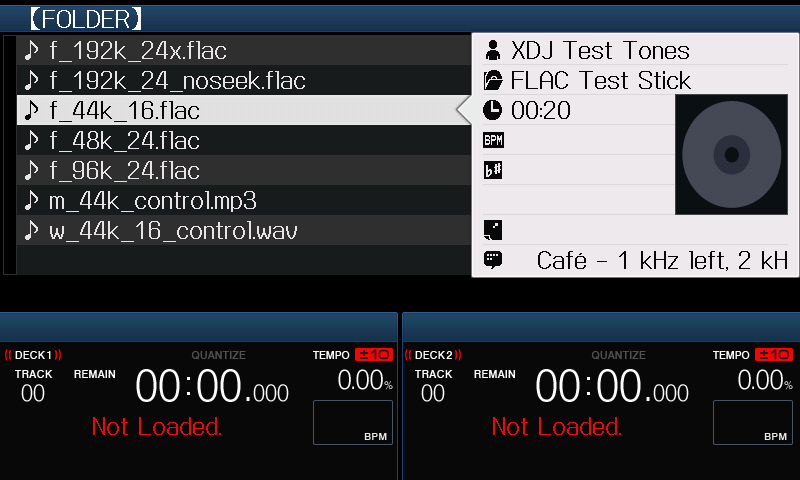
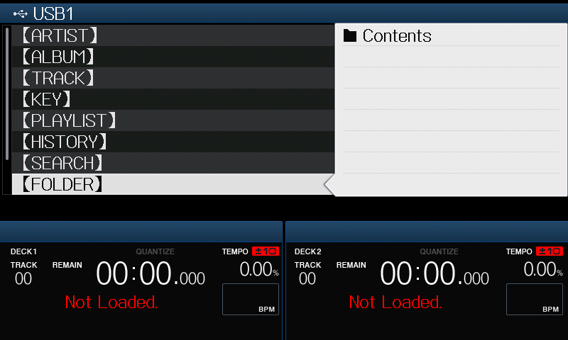
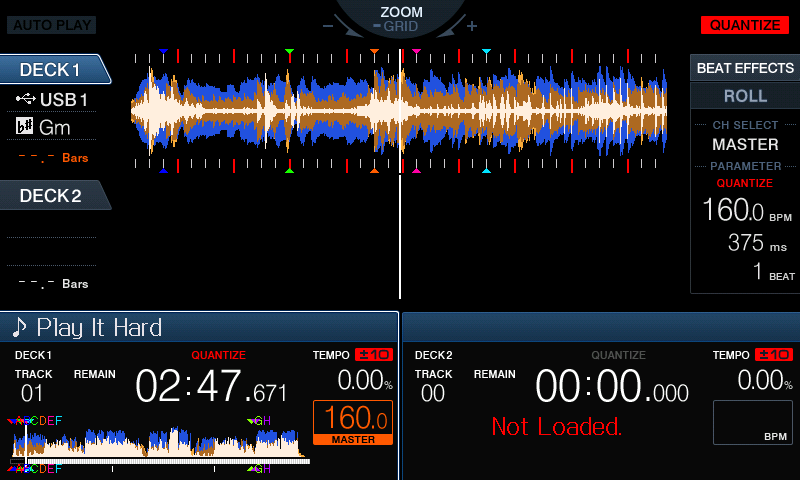
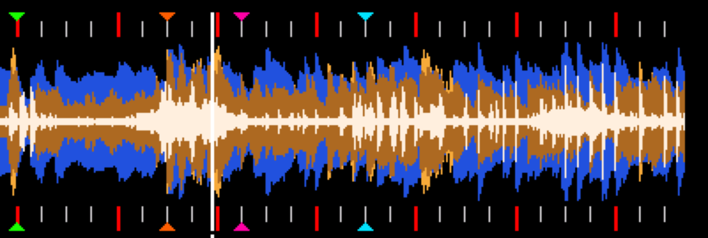
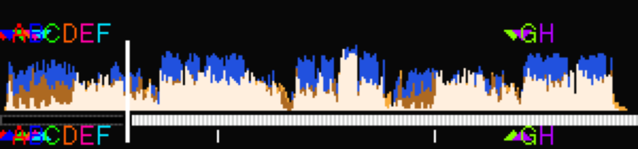
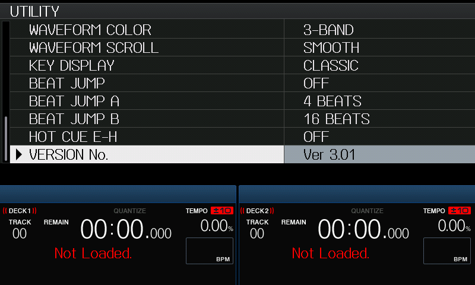

# XDJ-RX custom firmware 3.01 — release notes

[All releases](releases.md) · [changelog](../CHANGELOG.md)

Custom firmware 3.01 for the **Pioneer XDJ-RX** (the original model) adds **exFAT USB sticks**
and **FLAC** playback, plus features from later Pioneer DJ players: a 60 fps screen, colour
waveforms, hot cues E–H, beat jump, Camelot keys and more. It is the official firmware 2.21, unchanged, plus a small add-on library. Pioneer's own
software keeps running, and every add-on can be switched off with one button at power-on.

> **Unofficial, and not yet tested on a real XDJ-RX.** Not affiliated with, endorsed by or
> supported by Pioneer DJ or AlphaTheta. Everything below is verified in an emulator of the
> unit, which runs the real firmware. Installing firmware always carries some risk; you do it
> at your own risk.

## What's new in 3.01
| | What changed | Setting (UTILITY) | Default |
|---|---|---|---|
| **New: Camelot keys** | Keys shown in Camelot notation ("8A" instead of "Am"): in the browser's KEY lists and key columns, on the deck panel next to the waveforms, and SORT by KEY in Camelot order (1A, 1B, 2A …). Your stick isn't changed. | KEY DISPLAY: CLASSIC / CAMELOT | CLASSIC |
| **New: screen sync (experimental)** | Times the screen update to the display's refresh, to remove a tear line some units show through the waveform while it scrolls. For testing on real units: try the values and report what you see. | SCREEN SYNC: OFF / 1.5 / 3.0 / 4.5 / 6.0 MS | OFF |
| **Fixed: colours from the first moment** | When a track loads, the colour waveforms and the hot cues A–H in their colours show at once. 3.00 showed the stock blue waveform and green A–D cues until the track had finished loading. | — | — |

Updating from 3.00: install 3.01 like any update (below). Your settings are kept.

## All features

### Files and USB
| Feature | What it does |
|---|---|
| **exFAT USB sticks** | USB sticks formatted as exFAT now work: your rekordbox library, playlists and [FOLDER] browsing, just like any other stick. Many large USB sticks come formatted as exFAT. |
| **FLAC** | FLAC files play (16/24-bit, up to 192 kHz), from a rekordbox library or from [FOLDER], with title, artist, album, genre and comment shown. |
| **Better WAV** | WAV files in 32-bit, 32/64-bit float and up to 192 kHz play. Stock firmware plays 16/24-bit at 44.1/48 kHz only, and 24-bit at reduced precision. |
| **Contents in [FOLDER]** | [FOLDER] also shows rekordbox's `Contents` folder on a library stick, so you can browse the music files by folder. |

| FLAC with tags in [FOLDER] | [FOLDER] on an exFAT library stick |
|---|---|
|  |  |

### Screen and waveforms
| Feature | What it does | Setting (UTILITY) | Default |
|---|---|---|---|
| **60 fps screen** | The waveforms and screen update up to 60 times a second instead of 20. Scrolling waveforms move much more smoothly. | UI FRAME RATE: 20 (STOCK) / 30 / 60 | **60** |
| **Colour waveforms** | rekordbox's RGB or 3-band waveforms on the scrolling waveform and the overview. 3-band uses rekordbox's look: blue bass, amber mids, cream highs. Needs tracks analysed by rekordbox. | WAVEFORM COLOR: BLUE (STOCK) / RGB / 3-BAND | **3-BAND** |
| **Smooth waveform scrolling** | The scrolling waveform glides at sub-pixel steps instead of jumping a pixel at a time. | WAVEFORM SCROLL: ORIGINAL / SMOOTH | **SMOOTH** |
| **Hot cues A–H, in colour** | All 8 rekordbox hot cues appear on the scrolling waveform and the overview, each in the colour you gave it in rekordbox. Stock shows only A–D, always green. | always on | — |

*3-band waveform, hot cues A–H in their rekordbox colours on the scrolling waveform and the
overview.*

| Scrolling waveform | Overview |
|---|---|
|  |  |

### Performance
| Feature | What it does | Setting (UTILITY) | Default |
|---|---|---|---|
| **Hot cues E–H on the pads** | In HOT CUE pad mode, hold **SHIFT** and press pad A–D to play hot cue **E–H**, exactly like a normal hot cue (quantize, start from pause, hot loops, SLIP). While SHIFT is held, the pads that have an E–H cue light up. A pad without an E–H cue keeps its normal SHIFT function (delete hot cue). | HOT CUE E-H: OFF / SHIFT+PAD | OFF |
| **Beat jump** | Press **SHIFT + BEAT LOOP** to turn a deck's pads into beat jump (BEAT LOOP blinks): pad A / B jump back / forward by size A, pad C / D by size B. The jump keeps your position within the beat and keeps playing. Uses the rekordbox beat grid, otherwise the detected BPM. Press HOT CUE, BEAT LOOP or LOOP SLICE to go back. | BEAT JUMP: OFF / ON; BEAT JUMP A / B: 1–32 beats | OFF, 4 beats, 16 beats |

Beat jump and hot cues E–H work together: in beat jump mode the pads jump, otherwise SHIFT +
pads play E–H.

### Safety
- **Safe start:** hold **MIDI** (top panel) while you power on, until the splash screen. The
  unit starts the plain Pioneer software, with none of the 3.01 additions. Your settings are kept
  for the next normal start. Use it if anything ever misbehaves.
- **Factory reset** also resets the 3.01 settings to the defaults above.

## Settings
All settings are native rows in **UTILITY** (hold MENU), above VERSION No.:

| Row | Values | Default |
|---|---|---|
| UI FRAME RATE | 20 (STOCK) / 30 / 60 | 60 |
| SCREEN SYNC | OFF / 1.5 / 3.0 / 4.5 / 6.0 MS | OFF |
| WAVEFORM COLOR | BLUE (STOCK) / RGB / 3-BAND | 3-BAND |
| WAVEFORM SCROLL | ORIGINAL / SMOOTH | SMOOTH |
| KEY DISPLAY | CLASSIC / CAMELOT | CLASSIC |
| BEAT JUMP | OFF / ON | OFF |
| BEAT JUMP A | 1 / 2 / 4 / 8 / 16 / 32 BEATS | 4 BEATS |
| BEAT JUMP B | 1 / 2 / 4 / 8 / 16 / 32 BEATS | 16 BEATS |
| HOT CUE E-H | OFF / SHIFT+PAD | OFF |

UTILITY → VERSION No. shows **Ver 3.01**.

## Install

### 1. Make the firmware file on your computer
3.01 is made on your own computer from Pioneer's official firmware, so you need three
downloads:

1. **Pioneer's official XDJ-RX firmware 2.21**, from Pioneer DJ's website (XDJ-RX → firmware
   update). You get a zip file (`XDJ-RX_v221.zip`). Keep it as it is: you don't need to unzip it.
2. **The patch file** `xdjrx-3.01.xdjpatch`, from the 3.01 release page.
3. **The patcher** for your computer, from the same page:
   - Windows: `xdjrx-patcher-windows-x86_64.exe`
   - Mac: `xdjrx-patcher-macos`
   - Linux: `xdjrx-patcher-linux-x86_64`

Put all three in the same folder, then start the patcher:

- **Windows:** double-click `xdjrx-patcher-windows-x86_64.exe`. If Windows says "Windows
  protected your PC", click **More info** → **Run anyway**.
- **Mac:** right-click (or Control-click) `xdjrx-patcher-macos` → **Open** → **Open**. If
  macOS refuses, open **Terminal**, type `chmod +x ` (with a space), drag the patcher into the
  window, press Enter, then drag the patcher in again and press Enter.
- **Linux:** in a terminal, `chmod +x xdjrx-patcher-linux-x86_64` and run it.

The patcher asks for two files. Drag each into its window and press Enter:

1. the official firmware (`XDJ-RX_v221.zip`),
2. the patch file (`xdjrx-3.01.xdjpatch`).

It then checks that the firmware is Pioneer's official 2.21, downloads the firmware key from
Pioneer's public source code (about 280 MB, a minute or two on most connections), builds 3.01
and checks the result. When it says **Done**, the new firmware is in a new folder next to the
official one: **`XDJ-RX 3.01/XDJRX.UPD`**. If anything doesn't match, it stops with a message
and writes nothing.

For reference, the 3.01 `XDJRX.UPD` always has the MD5 **`42c92c706e8bd870c84199659212c052`**
(the patcher checks this for you).

### 2. Prepare a USB stick
1. Use a USB stick formatted as **FAT32** (on a Mac: "MS-DOS (FAT)"). **Firmware updates
   only work from FAT32 sticks** — this one and every future update, even with 3.01
   installed. exFAT works for playing music, not for updating.
2. Copy `XDJRX.UPD` from the `XDJ-RX 3.01` folder to the **root** of the stick (not into a
   folder). The file name must stay `XDJRX.UPD`.
3. Eject the stick properly.

### 3. Update the unit
1. Switch the XDJ-RX **off**.
2. Hold **USB STOP** and **RELOOP/EXIT** (deck 1), and switch the unit **on**. Keep holding
   until the screen asks you to connect a USB storage device.
3. Insert the stick into the top **USB1** port.
4. The update starts: progress bars for SUB and MAIN. **Don't switch off or pull the stick.**
5. When the screen says **"Firmware update is complete"**, switch the unit off, remove the
   stick, and switch it on again.
6. Hold MENU → UTILITY: **VERSION No.** shows **Ver 3.01**, with the new rows above it.

The update works from 2.21 or any earlier official version: the updater only installs a higher
version than the installed one, so 3.01 installs over 3.00 too.

## Going back to stock
- **Temporarily:** safe start (hold MIDI at power-on) runs the plain Pioneer software.
- **Permanently:** the updater only installs a version higher than the installed one, so the
  official 2.21 file won't install over 3.01. Pioneer's 2.21, unchanged but with a version
  number above 3.01, can be built with this project's tools (see *For developers* below:
  `xdj fw build build/XDJ-RX_v221.zip --overlay EMPTY_DIR --release NUMBER -o XDJRX.UPD`).
  This way back is verified in the emulator only.

## For developers: build 3.01 from source
The patcher rebuilds exactly what this repository builds. To build it yourself (macOS or
Linux, with Rust, Docker and the firmware key from `python3 tools/fetch_key.py`): put the
official zip at `build/XDJ-RX_v221.zip` and run `tools/fw/build-release.sh`; its output MD5
must be the one above. The patch file comes from `python3 tools/fw/make-patch.py`, the patcher
binaries from `tools/fw/build-patcher.sh`. Every step by hand: [firmware-mods.md](firmware-mods.md)
§1 and §13.

## Known limitations
- **Not yet tested on a real XDJ-RX.** CPU use of 60 fps, smooth scrolling and FLAC on the real
  unit is unknown. If something feels sluggish, set UI FRAME RATE to 30 or WAVEFORM SCROLL to
  ORIGINAL.
- Colour waveforms and hot cue colours need tracks analysed and exported by rekordbox. Other
  tracks show the stock blue waveform.
- **Firmware updates need a FAT32 stick**, also once 3.01 is installed (exFAT is for music only).
- Hot cues E–H are shown and played, but can't be set, moved or deleted on the unit. Use
  rekordbox for that.
- Embedded cover art in FLAC files isn't shown. The [FOLDER] view shows no embedded art for any
  format.
- Very large libraries (thousands of tracks): the first fast scroll through a huge list can
  cause audio dropouts, in stock firmware too. A fix is being looked at.

## Credits
- **JaNeinHub/XDJ-RX-Mod** (GPL-3.0) pioneered colour waveforms, smooth scrolling and beat jump
  for the XDJ-RX. Our versions are independent implementations inspired by it.
- **Deep Symmetry** (beat-link, rekordbox analysis-file documentation).
- **relan/exfat** (exFAT driver, GPL-2.0), libfuse (LGPL-2.1), musl (MIT), **dr_flac** (public
  domain / MIT-0).
- This firmware's own code is GPL-2.0-or-later; see the repository's `LICENSE` and
  `THIRD_PARTY_NOTICES.md`.
